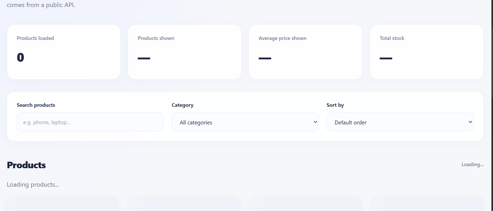
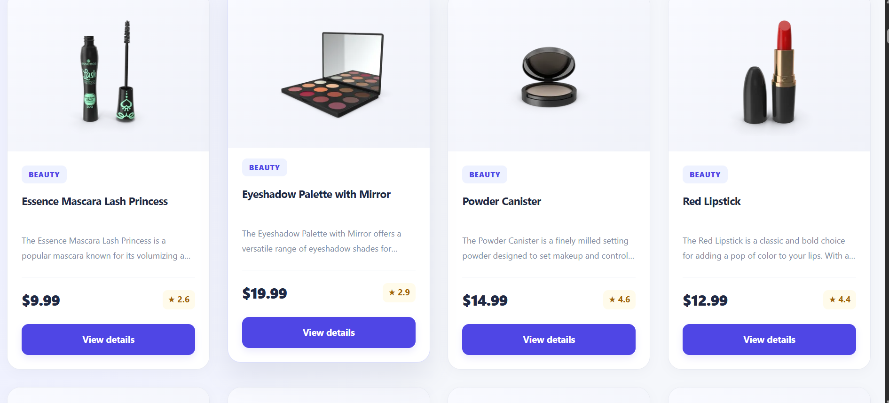
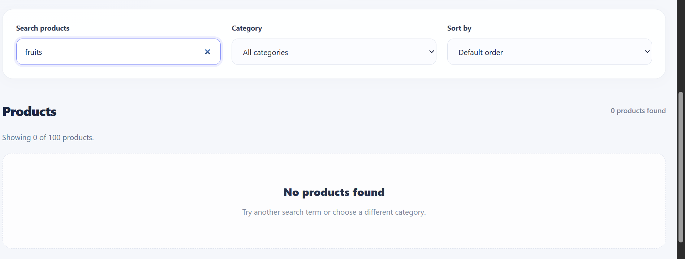

# Async Product Explorer

A responsive product explorer built with **Vanilla JavaScript, Vite, and Tailwind CSS v4**, using the [DummyJSON Products API](https://dummyjson.com/products).

## Features

- Fetch products and categories asynchronously.
- Display product cards with loading, error, and empty states.
- Search products by title.
- Filter products by category.
- Sort products by price or name.
- View detailed product information in a dialog.
- Display product statistics.
- Retry requests when loading fails.
- Responsive interface for different screen sizes.

## Technologies

- HTML5
- Tailwind CSS v4
- JavaScript ES modules
- Vite
- Fetch API and Promises
- DummyJSON API

## Getting Started

### Requirements

Install Node.js and npm.

### Installation

```bash
git clone https://github.com/Neema2023/week5-async-data-explorer.git
cd week5-async-data-explorer
npm install
npm run dev
```

Open the local URL printed in your terminal.

## Production Build

```bash
npm run build
npm run preview
```

## Screenshots

### 1. Loading State


### 2. Success State


### 3. Empty State


### 4. Error State


## API

This project uses the [DummyJSON Products API](https://dummyjson.com/docs/products) to retrieve product information and categories.

